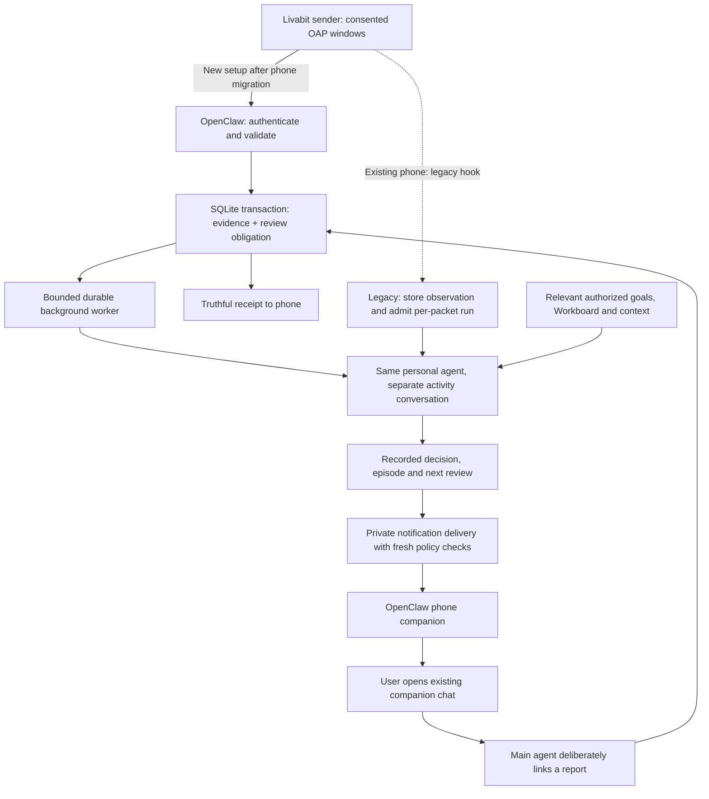

# Livabit current system and remaining work

Updated: **2026-10-15**. This is the entry point for the current product direction. Dated reviews preserve evidence for their own versions; a newer design does not transfer their test results to changed code. Requirements are in the [personal-agent specification](../specs/personal-agent-intervention.md), [architecture](../specs/system-architecture.md) and [acceptance criteria](../specs/acceptance-criteria.md).

**Current deployment:** the final host bundle/settings v2 were applied at 3:02:59 p.m. America/Chicago; all 17 source and three guidance hashes match. Warm native health, authenticated receipt/duplicate and main/foreign context checks passed at 3:13:21 p.m. Thirty regular healthy checks plus a healthy follow-up span 31 minutes 47 seconds, with original data unchanged and no runtime jobs. The gateway earlier took about seven minutes from process start to first observed health after its controller timed out; cold startup remains an open investigation. The 0.12 sender passed build/lint and all **97 exact-APK Android emulator checks**, including both real reboots. The physical phone still has its earlier sender/setup, so its compatible legacy hook continues per-packet analysis in the isolated session until physical migration. See the [processing review](review/personal-agent-processing-2026-10-15.md) and [sanitized host evidence](review/personal-agent-host-2026-10-15.json). Host health does not prove native model completion or physical background alerts.

## Purpose

Livabit gives the user's own personal agent permitted activity evidence so it can help the user understand and change unwanted device-use patterns over time. A meaningful continuing conversation, the agent's intelligence and authorized knowledge of the person are central. Runtime code supplies reliable facts and execution; it does not decide that an app, a duration or a fixed number of attempts proves harmful behavior.

The agent may ask about present intention or feeling when that answer would change its support. It can relate activity to an actual meeting, an actionable task, exercise, rest or another stated goal. It can be direct within the user's preferences and reconsider after repeated attempts. Intentional recreation and changed goals are valid. Automatic accountability emails, external escalation and device restrictions remain disabled.

The [research discussion](research/personal-agent-behavior-change-2026-10-14.md) distinguishes early evidence, including MindShift CHI 2024, from Livabit's hypothesis. The [conversation evaluation plan](evaluation/personal-agent-conversation.md) defines concrete scenarios. Installing guidance or passing storage tests is not evidence of long-term behavior change.

## Components and responsibilities

| Component | What it does | What it does not establish |
| --- | --- | --- |
| Livabit Android sender | Reads selected application usage through Android Usage Access; produces bounded OAP window estimates; buffers pending packets and retries within consent/expiry limits | Screen content, feelings, attention, complete coverage or exact background timing |
| OpenClaw gateway/plugin | Authenticates and validates input; deduplicates; stores evidence and runtime state; exposes bounded tools | That the model finished or that a phone alert appeared |
| SQLite activity store | Retains observation windows, decisions, episodes, reports and delivery bookkeeping locally in the chosen host | A complete personal memory, native chat history or a server operated by Livabit |
| Existing main personal agent | Reasons from available authorized context; asks, suggests, reflects or stays quiet; records its choices | Automatic access to every old chat, calendar or email account |
| OpenClaw Android companion | Receives the gateway's permitted native notification command and provides the existing companion chat | A permanently connected background socket merely because the app is installed or the phone is on |
| Shared Workboard | Canonical host-owned personal tasks across agents, including relevant open cards and notes | A new task list on the phone or a requirement that every suggestion must refer to work |

The Livabit sender and OpenClaw companion are **two different phone apps**. The sender reports activity. The companion displays this integration's intervention notifications and is where the user can open their existing agent chat. Livabit's own receiver-outage warning is a separate notification.

## Data and database

The activity database is **SQLite**, embedded through Node.js `node:sqlite` in our OpenClaw plugin. It is not a preinstalled OpenClaw activity feature or a separate database server. Our plugin creates its own `activity.sqlite` and schema. Its path is selected privately by installation; do not copy account paths or database contents into source control. See the [store implementation](../integrations/openclaw/personal-agent/store.mjs).

The phone's project-owned persistence is an Android private `sender.json` file written with `AtomicFile`, not this SQLite database. It holds settings, protected connection material, cursor/continuity and bounded pending packets. Android maintains its own system usage records behind `UsageStatsManager`; they are not a Livabit-owned database or a complete exported history. See [PublisherStore](../android/publisher-app/src/main/java/org/liveabit/publish/PublisherStore.java).

The original foundation contains these five tables; the October 15 source adds five runtime-work tables below:

| Table | Stored information | Important distinction |
| --- | --- | --- |
| `events` | Original source/event/sequence/window identity, UTC times, original packet hash, raw JSON while unexpired and parsed per-app estimates as JSON | Per-window evidence; apps are JSON in a row, not a separate normalized app table |
| `episodes` | Related topic/conversation ownership and lifecycle times | A thread of support, not a diagnosis or confirmed harmful pattern |
| `decisions` | The model's action, approach, rationale, prompt and follow-up description; optional supporting event | A recorded intention, not proof that a notification was sent |
| `feedback` | User reports, observed-behavior reports and agent-recorded outcomes with provenance | Reports/hypotheses must not be substituted for independently measured facts |
| `notifications` | Durable reservation and known invocation outcome for a stored decision | Confirmed invocation is not physical display, reading or benefit |

| New runtime table | Stored information | Why it exists |
| --- | --- | --- |
| `analysis_state` | Requested/settled review generations, earliest pending time/reason, latest settlement outcome and bounded follow-up count for an agent/session | Tracks the review checkpoint and execution budget without relying on conversation memory; settlement may mean expiry/exhaustion rather than successful reasoning |
| `analysis_events` | Event identity linked to the review generation that needs it, with a foreign key to retained events | Prevents replay from creating another obligation or double-counting usage; no duplicate raw-packet copy |
| `analysis_jobs` | One current job per owner: stable ID, due/deadline, target generation, attempts, lease, admitted run ID, bounded reason and exact bounded retry prompt | Coalesces input and recovers unfinished work across restart without changing an ambiguously admitted message |
| `analysis_decisions` | Stable review identity linked to its decision, trusted native run and optional once-only follow-up time | Prevents a retry from manufacturing another decision/timer when a model omits the event ID |
| `notification_jobs` | Decision-linked intent, exact private node/policy binding, useful expiry, next check, status and lease | Waits briefly for known pre-invocation unavailability while keeping uncertain invocation non-replayable |

These are **ten application tables in one SQLite database**, verified on the final installed bundle with SQLite quick-check passing and original user rows preserved. See [analysis store](../integrations/openclaw/personal-agent/analysis-store.mjs), [delivery store](../integrations/openclaw/personal-agent/delivery-store.mjs) and [host evidence](review/personal-agent-host-2026-10-15.json). The additive schema preserves observations and episodes; a narrowly configured legacy episode-owner alias makes earlier episodes available without rewriting native transcripts.

Daily usage totals are calculated on request from retained nonambiguous window estimates. There is no precomputed daily-total table in the foundation. Null duration remains unknown. Duplicates are counted once; overlapping source windows and local-midnight-crossing windows are excluded rather than proportionally invented. The returned exclusions and unknown coverage constrain any usage claim.

Episode recall keeps lifetime support/native-attempt counts and an advisory count of support decisions since the latest reported benefit. A helpful report early in a growing conversation cannot permanently hide later ineffective attempts. Equal-millisecond ordering between a decision and a feedback report is explicitly unknown. The cue suggests reconsideration after two supported later decisions; it neither proves that prompts were read nor chooses a stronger tone.

The foundation uses WAL journaling, full synchronization, foreign keys and bounded storage. Committed writes can reside in an accompanying WAL file until checkpointed; copying only the main file while it is open is not a documented backup procedure. SQLite is a local file-based engine; local storage does not mean model inference is local. The configured model provider receives the prompt and retrieved context supplied to it. ([SQLite usage guidance](https://sqlite.org/whentouse.html), [WAL documentation](https://sqlite.org/wal.html))

### Retention and copies

Raw packet JSON expires at the packet's original `expires_at`; replay cannot renew it. The installed foundation defaults retain derived event metadata/per-app windows for 30 days from window end and episodes/children for 90 days from episode creation. Configured limits and actual running settings must be verified separately. Original packet expiry is not a promise that all derived or conversational copies disappear at that instant.

Cleanup runs on store operations and, while the enabled plugin/service has valid settings and a usable gateway, at startup and periodically. A stopped host cannot perform a physical deletion on schedule. Native chat transcripts, curated agent memory, model-provider copies and backups have separate lifecycles. Stopping phone sharing prevents new collection/sends; it cannot recall already received data. No forensic-erasure claim is made.

## Receipt, analysis and delivery

[ADR-0025](decisions/0025-durable-activity-analysis.md) changes the pipeline to durable receipt plus independently scheduled reasoning in an activity session belonging to the same main agent. The source implements receipt and a pending analysis obligation in one transaction. Local tests and installation/native results must still be recorded separately; a new schema or document alone is not a live migration.

| Endpoint | Acknowledgement | Model relationship |
| --- | --- | --- |
| New `/liveabit/activity` | HTTP 200 with literal `ok:true`, `format:liveabit.activity-receipt.v1`, `durable:true`, matching `event_id`, SHA-256 of exact received wrapper bytes, disposition and `analysis_scheduled` | Commits receipt/review obligation; does not directly admit a model run and returns no `runId` |
| Legacy `/hooks/liveabit` | Existing literal `ok:true` and nonempty `runId` for eligible run admission | Remains a compatibility path with per-packet native analysis, now isolated; it does not add the new durable worker obligation |

Both authenticate with the separate activity hook bearer token; neither uses activity content as authority. The new receipt hash binds the exact HTTP wrapper bytes and is distinct from the stored canonical OAP hash. The sender removes pending bytes only after a matching acknowledgement for its supported endpoint. An existing 0.11 sender must not be silently switched to the new contract; compatible sender support and private setup import require their own build/verification. OAP body identity, original expiry and consent are unchanged.

The **0.12.0-poc sender candidate** adds this receipt contract while retaining the legacy path. Its exact build/emulator results belong with that release. A physical phone update and private setup import are still separate steps when the device is unavailable; implementing the candidate does not move an already installed 0.11 phone to the new endpoint. Until that migration, its legacy hook remains compatible but retains per-packet analysis.

The solid receipt path is deployed on the host but awaits phone migration; the dashed legacy path is the older physical sender's current route. Neither is proof of every end-to-end stage. A notification has no new inline reply control: the user uses the existing chat, and only a deliberately linked report creates the review shown here. Source/hash/loading, native exercise and migration evidence remain separate. The October 14 foundation remains historical evidence; its old main-chat path and absent worker/queue do not describe the new code.

Default coalescing waits five minutes after an eligible new observation; a new packet cannot keep pushing an already due review later. A lightweight worker checks every 30 seconds, claims work with a 90-second lease and permits at most five dispatch attempts. Failure backoff starts at 30 seconds and caps at five minutes. A review's useful deadline is its scheduled due time plus 15 minutes; packets already at least 15 minutes old are retained without creating a fresh activity review. New input during a running review gets a later pending generation. Native run admission is retained separately from terminal completion; a partial decision record does not mark the whole review complete. Expired or exhausted work is an observable settlement, not a successful conversation.

Successful native completion can still lack a recorded model choice. In that case the worker settles the job with `decision_recorded:false` and stores `completed_without_decision` in `analysis_state.last_outcome`; it does not invent `no_intervention` or retry a completed run. A bound explicit no-intervention decision remains a distinct recorded choice. This is a processing diagnostic, not evidence that the model understood the person or that a notification was seen.

Analysis and notification checks run independently, so slow model admission cannot starve delivery checks. Availability checks are bounded at five seconds, model admission at 45 seconds, and run-status transport at five seconds; inventory reads are bounded at 15 seconds. Stop/restart generations fence old continuations. Each scheduled prompt has a 48 KiB JSON-evidence presentation budget and at most 52 KiB total, marks truncation and persists the exact message for ambiguous admission retry. This derived snapshot may include episode reports and summaries; it is not an additional original-packet archive. Deliberate context retrieval remains available for omitted detail.

`liveabit_schedule_review` allows a live scheduled activity review to request one future review in 1–1440 minutes after recording its decision. It is idempotent per review and allows at most three agent-requested follow-ups until fresh accepted activity or a deliberately linked main-chat report resets the execution budget. Duplicate packets do not reset it. A failed/unsupported scheduling result is not a timer; descriptive `followup` text remains evidence only. A linked `user_report` requests prompt review atomically with the report. Three is a resource bound, not a clinically researched dose or an intervention escalation count.

The installed SDK supplies authoritative native run/call identity through tool-call hooks rather than the tool factory itself. The plugin binds each activity tool invocation to those trusted identities, checks the active scheduled job/deadline and fails closed for missing, replaced or expired bindings. This prevents early tool execution or lost admission responses from creating unlinked duplicate decisions. Ordinary chat still has only its narrower context/feedback bridge.

The activity session is `agent:main:liveabit-activity`; ordinary chat is `agent:main:main`. The activity session may use context, decisions, feedback, notification and scheduling tools. Exact ordinary main chat may retrieve the same bounded context/episode ledger and record deliberately linked feedback; it cannot create activity decisions or send notifications through this runtime. Foreign/sandboxed sessions are denied. Ambiguous replies need clarification rather than guessed attribution. Sharing identity preserves configured identity/access rules, not automatic access to another transcript. Old packet text already in ordinary chat is not removed by routing new input elsewhere.

A linked main-chat report atomically cancels old unreserved queued/checking prompts before requesting reconsideration; an already reserved possible native effect remains governed by its one-attempt record. A new trusted reply/follow-up review can choose a new approach supported by the same activity window. Event identity anchors the factual evidence, while review identity deduplicates the reasoning operation. Legacy packet replay remains deduplicated. This permits adaptation without dropping an evidence link or bypassing notification policy.

## What dependable background delivery means

There are two independent background paths. The sender must get activity to the gateway without requiring its Activity to stay open. The companion must remain reachable enough to receive a native notification while its UI is closed. A working sender does not prove a working companion connection.

Host recovery should distinguish known pre-invocation disconnection from uncertain invocation. Waiting for a disconnected phone can be bounded by the message's useful lifetime; after a possible side effect, blindly repeating a command can create duplicates. Every dispatch must recheck destination, current consent/preferences, quiet hours, cooldown, evidence age and native capability. Reconnection after a long outage should prompt current reassessment, not a burst of old nudges.

The new queue allows at most eight pre-invocation inventory/connectivity checks, with backoff from 30 seconds to four minutes. Its deadline is the earliest of decision creation plus 15 minutes, supporting event end plus 15 minutes and original expiry. An absent, unpaired, ambiguous or permission-denied phone does not qualify for delayed delivery. Changed policy cancels waiting intent. A newer queued prompt supersedes the older unreserved queued/checking prompt for that owner. Once a native command has been reserved and might have crossed the invocation boundary, uncertainty consumes that attempt; a lost acknowledgement cannot justify replay.

Being installed, powered on or previously paired is insufficient evidence of a live connection. Tests can simulate offline status, reconnect, crash and uncertain acknowledgement. They cannot prove a particular Android/OEM keeps a socket alive under battery restrictions. Physical checks need the companion backgrounded, screen off, network loss/return and a displayed notification; keep these distinct from stub and emulator results.

The October 15 gateway snapshot at 3:27:41 p.m. America/Chicago reported the configured paired phone node disconnected, with notification capability/permission last advertised. At 3:33:40 p.m., native presence had no tracked Android node or ordinary UI connections; no operator/node split was observed. This does not prove the phone was off, the app absent or why it disconnected, and is distinct from the earlier user-reported Connected display. The [processing review](review/personal-agent-processing-2026-10-15.md) records times and limits. The measured host cold-start delay also occurred during concurrent development/emulator work; it remains an open investigation rather than an idle benchmark for all installations.

## Evidence levels and remaining work

| Level | What counts | What must not be inferred |
| --- | --- | --- |
| Specified | Current requirement, ADR and acceptance mapping | That code exists |
| Implemented | Reviewed source with exact revision | That tests, installation or physical behavior passed |
| Locally tested | Repeatable automated fixtures/build checks with their scope | Actual native SDK interoperability, phone display or psychological benefit |
| Installed | Matching source/configuration in the user's running host | That a positive activity event completed every stage |
| Natively exercised | Actual gateway/tool/model or phone invocation with safe evidence | Physical display, reading or useful behavior unless separately observed |
| Physically observed | User/device evidence under stated conditions | All-device background reliability or sustained benefit |
| User-assessed usefulness | The user's experience and goal follow-through over time | General clinical or long-term efficacy |

The [October 15 processing review](review/personal-agent-processing-2026-10-15.md) records the implementation/evidence matrix, independent review fixes and separate desktop availability finding. It must identify any still-pending native installation/health, exact candidate build and phone migration. Scenario evaluation and physical background checks remain separate from mechanical tests. No open requirement can be marked complete merely because a tool exists. Automatic accountability emails stay disabled throughout. The [roadmap](project-roadmap.md#personal-agent-work) and [PA traceability](../specs/requirements-traceability.md#personal-agent-requirements) track these obligations.
