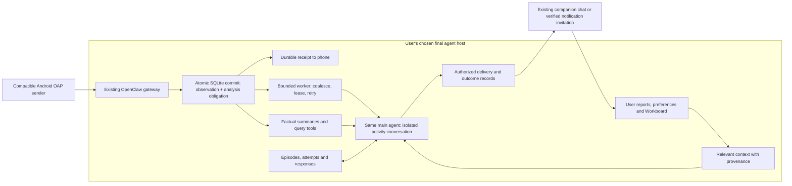
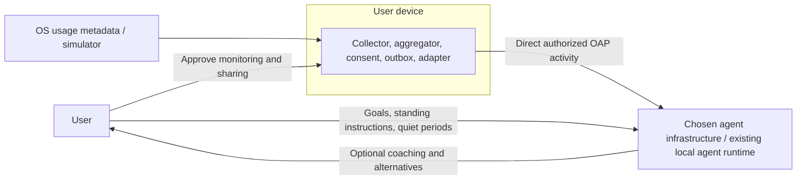
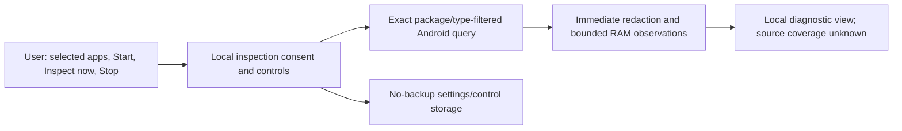
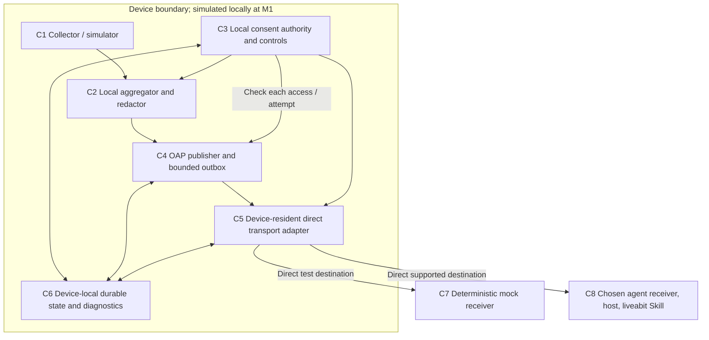

# System architecture

**Current architecture direction, 2026-10-15:** Android sends permitted OAP observations directly to the existing OpenClaw gateway. [ADR-0024](../docs/decisions/0024-personal-agent-behavior-change.md) establishes the personal-agent relationship; [ADR-0025](../docs/decisions/0025-durable-activity-analysis.md) separates durable receipt from leased/coalesced analysis in an isolated activity session of that same main agent. SQLite remains embedded in the final host. The model owns behavioral judgment; runtime code owns factual admission, durable scheduling, retention and explicit delivery controls. Companion chat is first and automatic accountability emails remain disabled. The [current system guide](../docs/current-system.md) records the final installed bundle/native checks separately from model execution, physical migration and behavioral evidence.

## Personal-agent host architecture



The diagram describes the new receipt path's responsibilities, not an end-to-end completion claim. The October 15 installed host implements independent analysis, activity-session isolation, deliberate reply/context sharing, bounded future reviews and notification recovery. The physical phone still uses compatible legacy per-packet admission until validated APK/setup migration; the [current-system diagram](../docs/current-system.md#receipt-analysis-and-delivery) shows both paths. An invented run ID is not a receipt. Native HTTP/source checks do not prove scheduled model execution, physical display or useful adaptation. The October 14 foundation's inbox/query/episode evidence remains dated to its own version. A record-writing tool is not a scheduler; a persistent session is not a complete archive.

| Component | Responsibility | Evidence boundary |
| --- | --- | --- |
| PA-C1 | Validate and durably admit permitted immutable observations; preserve original time and uncertainty, deduplicate and bound retention | Inbox/restart/conflict tests and installed gateway ingress |
| PA-C2 | Retrieve bounded relevant windows and factual summaries with provenance, gaps and truncation | Query/summary fixtures; no distraction or emotion classifier |
| PA-C3 | Maintain user-owned context and corrections, distinguish user reports from hypotheses and retrieve relevant Workboard context | Context tools and actual accessible host context |
| PA-C4 | Model-owned choice, optional feelings inquiry, contextual persuasion and reconsideration | Observed conversations/scenarios; no automatic pressure escalation |
| PA-C5 | Record episodes, choices, attempts, user responses and unknown outcomes | Durable record tools first; lifecycle and reply linkage separately tested |
| PA-C6 | Enforce explicit channel/destination/timing authority, reserve delivery and record failure/uncertainty | Separate delivery/recovery checks; chat, invocation, display and response are distinct |
| PA-C7 | Persist analysis obligations with receipt, coalesce/lease work, retry bounded failures and track reviewed input | Crash/transaction/claim/concurrency/native-terminal-state checks; no model-per-packet or exactly-once promise |
| PA-C8 | Isolate the activity session and expose deliberate bounded evidence/reply sharing with main chat | Exact trusted session/tool access, provenance and ambiguity checks; no automatic transcript inheritance |

Accepted observations remain in the final chosen host. A local embedded database is allowed here; a separately operated store or forwarding process violates the direct topology. Retrieve selected evidence for reasoning rather than requiring the model to retain every packet in prompt context. Keep factual summaries auditable and avoid repeated counting of retries or overlapping observations. Rich personal context never flows back to Android.

The phone's private `sender.json` is a bounded retry/settings file, distinct from the host's plugin-created `activity.sqlite` database. The SQLite engine is supplied by the Node.js runtime, not a separate database service or standard OpenClaw activity store. Per-app window data is stored as JSON within event rows; daily estimates are derived on read. Native transcripts and provider copies have their own retention, so database pruning cannot claim to erase conversational copies. The configured model may run remotely even though storage is local. See [data inventory and limits](../docs/current-system.md#data-and-database).

Behavioral interpretation remains flexible: runtime code must not decide that an app, duration or attempt count establishes a harmful habit. The agent may ask about feelings, use an explicit report to revise a hypothesis, suggest a smaller action, change timing or reconsider the goal. Mechanical limits come only from explicit permissions/preferences and resource/reliability budgets.

## Preserved OAP and integration architecture

The dated POC descriptions below preserve tested implementations. ADR-0024 governs the current personal-agent direction; historical main/liveabit/WhatsApp routing is not a claim about the newly installed configuration.

**Previous POC communication path, 2026-10-13:** Android sent meaningful observations directly to `/hooks/liveabit`, fixed to dedicated liveabit and persistent `agent:liveabit:main` with `deliver: false`. Main managed Workboard tasks; selected reminders used the paired companion's `system.notify` command under [ADR-0023](../docs/decisions/0023-openclaw-companion-reminders.md). Native invocation success did not establish physical display or offline recovery.

**Phone confirmation, 2026-10-11:** The user reported that both WhatsApp connection-check messages arrived with a notification. [Confirmation](../docs/review/openclaw-phone-notification-2026-10-11.md). Use the existing tested 0.6.0 APK for the [real-activity phone trial](../docs/integration-drafts/openclaw-phone-pilot.md); its bytes are unchanged.

Version: baseline 0.2 with agreed OAP 0.1.0 refinements and **selective-phone-delivery update, 2026-10-11**; original baseline date remains 2026-10-03. The [contract](protocol/oap.md), Windows acceptance and collector baseline retain their scopes. [ADR-0018](../docs/decisions/0018-existing-main-agent-context.md) selects main and the native server-owned conversation mapping. Preserve the verified [0.5.0 main-agent review](../docs/review/openclaw-main-agent-2026-10-11.md), [0.4.0 dedicated-agent review](../docs/review/openclaw-poc-2026-10-11.md) and earlier target evidence. WhatsApp is linked/connected. Sender 0.6.0 clarifies local replies and separately authorized nudges, and passed all 37 native checks; [review](../docs/review/openclaw-whatsapp-2026-10-11.md). Earlier live-hook HTTP 5xx failures are retained with cause unconfirmed. Sol 6.1 completed a separate operator run; medium is verified inherited configuration, not direct effort telemetry. The explicit WhatsApp own-chat check received a provider message ID with unchanged agent/model settings. Goals/history/model choice stay in OpenClaw; full M2/M3, physical-phone activity delivery and production transport conformance remain separate claims. Collector accuracy/coverage work and Linux remain deferred.

## Decision

**The activity provider sends directly from the user's device to the user's chosen agent infrastructure.** Collection, consent, aggregation, transport adapters, credentials and bounded pending activity live on the device. No project-operated delivery service, hosted adapter, remote consent authority, database, queue, proxy or relay is permitted. A free hosting tier or user-hosted forwarding bridge does not satisfy this constraint.

The receiving endpoint belongs to the chosen agent's existing infrastructure or runs within its existing local agent runtime. Provider-operated ingress can be part of that destination where actually supported. A separate service forwarding activity onward is an intermediary regardless of its operator.

OAP stays independent of MCP and agent vendors. Start with a direct publisher-to-mock-receiver reference profile. MCP Events is conditional: device-resident discovery, onboarding, subscription renewal and delivery must all work without an intermediary. An outbound webhook POST alone is insufficient. See [ADR-0001](../docs/decisions/0001-independent-oap-mcp-adapter.md), [ADR-0005](../docs/decisions/0005-no-intermediary-infrastructure.md) and [feasibility](../docs/research/feasibility.md).

## System context



This is the production activity path. The separate accepted inspector stops at the device; the native sender POC now implements direct delivery to OpenClaw. The project supplies software and a contract, not an operated bridge. Goals and private memories stay with the agent; restriction capabilities remain outside the initial release.

## Accepted local Android inspection boundary

TASK-P6-F02 implements the [local collector specification](android/local-inspector.md) before M2. Plain Java keeps a JVM-testable inspection core separate from Android permission/query and UI/storage boundaries. The user selects exact packages, grants broad OS usage access separately, starts local inspection and requests each read while the app is visible. No inventory enumeration, class/content/extras access, export, background scheduling or networking is present.



This isolates C1/C2/C3/C6 preparation; it creates no recipient grant or C4/C5 delivery state. Activity remains in RAM and is cleared on Stop, fresh Start, scope mutation, authority/clock failure or process restart. Only settings/control use credential-encrypted no-backup storage. A stopped new process requires an explicit Start; normal app switching preserves the current session horizon but cancels pending reads while hidden. Query results are rechecked against current OS permission, scope, generation, lifecycle and clock state before ingestion/display. Unknown or failed authority/storage fails closed.

Only package identity, timestamp and resume/pause type are projected. Public Android query APIs do not attest initial state or complete continuity: observed events and closed inferred intervals remain local diagnostics with unknown coverage. Empty/unavailable/ambiguous history never proves zero usage; no OAP conversion or receipt exists. Source and JVM checks do not prove a merged APK manifest or physical-device behavior.

## Verified dedicated-agent Android 0.4.0 baseline

The separate [native sender](android/test-publisher.md) implements selected-app observation construction, protected connection settings, a bounded durable outbox, delivery jobs and configurable missing-acknowledgement warnings directly in Android. It emits the [experimental OAP observation family](protocol/activity-observation.md), preserving unknown coverage and nullable unverified estimates. The agreed 0.1.0 measured-summary contract remains separate.

Its C5 mapping sends the original canonical observation inside a fixed `/hooks/agent` request to the installed OpenClaw runtime, with a dedicated hook token, fixed `liveabit` agent, `deliver: false` and the original event ID as `Idempotency-Key`. Request bytes are persisted before dispatch and reused unchanged. A valid HTTP 200/run ID acknowledges admission; completed interpretation and user notification are separate. OpenClaw's verified five-minute in-memory idempotency cache is not durable, so duplicates remain possible.

C8 is the existing OpenClaw runtime and dedicated activity workspace, using the configured model and liveabit Skill guidance. The ordinary host tool catalog is denied and hook channel delivery/heartbeat are disabled. Built-in CodeMode still exposes JavaScript `exec`/`wait` and `skills.read`; the observed run read the Skill. This is not a zero-tool or no-execution guarantee. The independent desktop receiver remains a final display/test consumer and never forwards to OpenClaw.

Exact sender 0.4.0 APK bytes passed 31 native Android 15/API 35 checks, including installed-gateway admission. Separate agent history interpreted the owned fixture while retaining unknown coverage and unverified duration. An additional native emulator-to-host-LAN admission check passed through the user-approved Wi-Fi setup. Physical-phone delivery is untested. The local HTTP POC is not formal TLS/profile conformance or completion of M2/M3. No intermediary infrastructure or preliminary JavaScript sender is introduced.

## Verified existing-main-agent 0.5.0 POC

[ADR-0018](../docs/decisions/0018-existing-main-agent-context.md) retains the native collector/outbox/transport but makes agent selection explicit and saved. The mapped `/hooks/liveabit` route requires main, fixes the canonical main conversation in OpenClaw configuration and uses persistent session mode to create or reuse it. Its record was absent before setup, so the first hook created it; earlier chats were not imported. Caller session-key selection remains disabled. The built-in `/hooks/agent` path still supports isolated configured-agent runs and legacy liveabit setup. Content cannot override either routing decision.

The helper installs liveabit Skill in main's existing workspace and merges necessary hook/skill allowlists while preserving prior entries. Main's configuration entry and AGENTS were unchanged; model, ordinary tool policy, heartbeat, other skills and unrelated settings are retained. Dedicated-agent restrictions do not apply to main. Context stays in the host. The app/helper do not read or copy private goals, memories or chat history. The completed synthetic main response retained uncertainty; it does not establish earlier-chat context or private-goal use.

Native UI displays the selected agent and derives Wi-Fi/USB help from the actual endpoint/port. Legacy settings remain liveabit and queued wrappers are not rewritten; switching endpoint/agent requires explicit Start and pending-activity confirmation. The exact 0.5.0 APK passed 37 Android 15/API 35 checks and native main admission, with separate completed main output and additional emulator-to-host-LAN admission. Physical-phone activity delivery remains untested. No intermediary or new agent account is introduced.

## Historical selective-delivery development

Sender 0.6.0 changes the fixed introduction for newly constructed hook requests to clarify ordinary local replies versus separately authorized host-policy nudges. Persisted pending bytes remain unchanged. `deliver: false` prevents automatic hook announcements; main's communication tools can separately use its private Skill policy to send selectively to the linked WhatsApp account's verified own identity. Incoming direct/group chats remain disabled. Default 60-minute cooldown and 22:00–08:00 America/Chicago quiet hours are editable best-effort agent instructions, with no unsolicited nudge when goals/context are missing. Provider send acknowledgement is verified for the explicit own-chat check; phone receipt and notification for the checks are user-confirmed; selective coaching remains unproved. The exact final 0.6.0 APK passed all 37 native checks, including live delivery. A separate main-agent private-policy/native-message check succeeded; phone receipt and notification for the checks are user-confirmed. Goal-grounded nudges are ready for a real-activity trial.

The user owns model/thinking choices. Activity and WhatsApp setup preserve them; a separate explicit helper can apply the user's choice while retaining provider authentication and conversation identity. The requested `openai/gpt-6.1-sol` model completed a trusted operator run without changing conversation identity. Medium is saved configuration with no session/hook override and source-confirmed inheritance; run telemetry did not directly report effort. Android neither chooses the model nor copies private agent context.

## Components and local state



| Component | Responsibility | State |
| --- | --- | --- |
| C1 | Simulate at M1; selected-package native local inspection first; later production collection; immediately discard incidental denied packages/fields | Short-lived approved device observations |
| C2 | Compute windows and coverage; apply each recipient's scope | Local permitted aggregates, no intention classification |
| C3 | Bind device/user/recipient, consent revision, scope, expiry, pause/revocation | Local grants; no remote consent replica or goals |
| C4 | Validate/persist authorized envelopes; immutable IDs; bounded replay | On-device outbox, retained history, ordering/gap metadata |
| C5 | Pair with a supported receiving endpoint; authenticate and send directly | Recipient endpoint/configuration, scoped credentials, connection state |
| C6 | Atomic local consent/outbox changes; crash recovery and safe status | Device-local state and bounded diagnostics |
| C7 | Validate, deduplicate and order synthetic records | Final mock receiver ledger; never a forwarder |
| C8 | Receive and interpret using available agent context; choose communication | Agent-owned context/receipts/retention, as supported |

An adapter is code in the device or existing agent runtime, not a hosted product component. No project-wide user account, cloud registry, shared cloud credential or remote operator dashboard is required. A local transactional store is justified by crashes, restart recovery and consent races. [ADR-0003](../docs/decisions/0003-minimal-durable-reference.md)

## Direct event delivery

```mermaid
sequenceDiagram
  participant P as Device aggregator
  participant S as Device consent / outbox
  participant A as Device transport adapter
  participant H as Chosen agent receiver
  participant U as User
  Note over A,H: A valid direct pairing/control path is required first
  P->>S: Authorized locally aggregated window
  S->>S: Redact, validate, persist immutable recipient envelope
  A->>S: Check current local consent and endpoint authorization
  A->>H: Direct authenticated event
  alt Receiver accepts
    H-->>A: Profile-defined receipt
    A->>S: Record receipt within original retention deadline
    H->>H: Validate / deduplicate / evaluate as supported
  else Network failure / timeout / lost receipt
    A->>S: Retain event and bounded retry state
    Note over S,H: Acceptance may have happened despite lost receipt
  end
  opt Allowed reconnect opportunity within retention
    A->>S: Recheck consent, expiry, rate and retry budget
    A->>H: Direct catch-up with unchanged ID and body
    H-->>A: Receipt if supported
  end
  opt History expires or capacity is exhausted
    S->>S: Evict according to policy; keep bounded gap status
    A->>H: Report missing coverage through supported profile
  end
  opt Host judges a message appropriate
    H->>U: User-authorized response or alternative
  end
  U->>S: Pause / revoke recipient locally
  S->>S: Commit and fence future reads and attempts
  A->>S: Next attempt denied, including while offline
```

No intermediate component accepts responsibility for forwarding or guaranteeing delivery. Receipt, valid consumption, evaluation and notification are distinct. C7 proves consumption in tests; C8 evidence depends on the real host.

## Pairing and authorization

```mermaid
sequenceDiagram
  participant U as User
  participant D as Device controls / consent
  participant A as Device adapter
  participant H as Chosen agent infrastructure
  U->>D: Approve monitoring and permitted metadata
  D->>U: Obtain separate OS usage access in Phase 6
  U->>D: Choose recipient, apps, fields, cadence, retention
  D->>D: Persist local grant
  U->>H: Authorize connection through supported host setup
  H-->>A: Supported endpoint / scoped pairing material
  Note over A,H: Logical requirement; no universal agent API is claimed
  A->>H: Verify identity and authenticate
  H-->>A: Accept connection and declare supported capabilities
  A->>D: Bind endpoint/credentials to local grant
  U->>H: Give standing instructions and notification preferences
  U->>D: Pause / narrow / disconnect
  D->>D: Commit locally; stop future affected reads / sends / retries
  D->>A: Purge affected queue and credentials as required
  opt Host supports cleanup
    A->>H: Best-effort unsubscribe / revoke pairing
  end
```

This is a logical lifecycle, not a finished wire API. Phase 3 must specify actual supported pairing/authentication profiles. Use host-native OAuth, keys or scoped tokens where documented; do not create a project-hosted identity service. A URL alone proves neither identity, subscription nor sending authority. A host lacking a supported onboarding/control route is unavailable; retries cannot manufacture one.

For MCP Events, the host initiates discovery/subscription and supplies the callback URL and secret to the publisher. Refresh needs control connectivity too. The phone cannot invent those credentials or use a generic chat URL. A direct/provider-owned control path must be demonstrated before outbound event delivery qualifies.

## Aggregation and protocol boundary

Default to retrospective application-duration windows. Effective collection scope is the union of active approved scopes, then recipient-specific redaction. Empty scope stops queries. Broader older-API results may enter memory transiently; discard denied fields/packages before aggregation, persistence, diagnostics or export. Never query content.

Approved raw observations stay local and are discarded after aggregation/checkpointing within the proposed 24-hour maximum and any shorter applicable limit. Clip to authorized segments or drop inseparable mixed windows with missing coverage; never prorate full-window totals to invent post-consent activity. Retry, replay, renewal, projection and republication cannot reset original retention deadlines.

Distinguish measured zero from denied access, incomplete sessions, delay and unavailable history. Foreground app durations can overlap and do not measure exact attention or elapsed screen time. Use platform-namespaced app identities and minimize cross-recipient correlation. Live/session updates remain deferred. [ADR-0002](../docs/decisions/0002-local-summary-aggregation.md)

| Planned area | Phase 3 obligation |
| --- | --- |
| PA-01 | Envelope/taxonomy, metric/coverage, identifiers, time, schemas/examples |
| PA-02 | Direct capabilities, local recipient subscriptions/filters, finite lifetimes |
| PA-03 | Host-supported pairing/auth profiles, local consent, expiry and revocation |
| PA-04 | Receipt levels, bounded retries/recovery, ordering/deduplication, replay/gaps |
| PA-05 | Size/rate/batch limits, coalescing/pagination, retention and backpressure |
| PA-06 | Versions/extensions, canonicalization and independent conformance |
| PA-07 | Direct reference transport and conditional host/MCP mappings; full lifecycle |
| PA-08 | Device-local safe status/audit interfaces and errors |

These are planning areas. The direct reference profile is mandatory; MCP is conditional. Local retained recovery does not imply a hosted history/read service or universal host-initiated subscription API.

## Reliability inside the device budget

Delivery is **best effort with bounded retry and retained recovery**. Neither eventual nor exactly-once delivery is promised. A reachable compatible receiver should receive retained records after a tested finite outage; indefinite outages, expiry, full storage, OS restrictions, unknown receipts or unsupported onboarding can still cause loss.

Improve reliability locally: persist before dispatch; immutable IDs/bodies; exponential backoff/jitter and retry hints; allowed network/foreground resumption; catch-up coalescing with honest coverage; profile-defined receipts; receiver deduplication; budgets, expiry and permanent-error stopping; durable gap/checkpoint state. Do not default to permanent Android background connections or model calls per observation.

Keep the proposed 15-minute windows, four fresh events/hour/recipient maximum, 16 KiB/event, 64 KiB catch-up, 24-hour/4 MiB history, and six attempts/cycle for review. A changed network/foreground opportunity may initiate another explicitly bounded cycle while grant/history remain valid. Phase 3 must define resets/backpressure so recovery cannot produce retry storms.

## Local revocation and security

C3 is the sole provider-side consent authority. Local pause/narrow/revoke fences new affected reads, sends and retries immediately after commit, including offline, and survives restart. Disconnecting one recipient preserves others; global monitoring off stops all OAP collection. Already-sent requests and host copies cannot be recalled.

The former remote consent authority, synchronization, pending remote-disconnect state and 20-minute lease are removed. Optional host cleanup may remain pending without weakening completed local disconnection. Published envelopes are immutable. Baseline 0.2 allowed fresh projections only with new identities and safe replacement semantics; accepted [ADR-0006](../docs/decisions/0006-immutable-finalized-summary-pages.md) defers all finalized-window projections and purges old-stream history on scope change in OAP 0.1.0.

Remote receivers require authenticated HTTPS and profile-appropriate integrity. A paired local agent may use an explicitly authorized LAN endpoint with peer authentication/encryption. Reject payload-selected destinations, redirects, untrusted peers and unexpected addresses. Remote and local profiles must have explicit destination policies; do not globally disable checks. Callback verification, signing, OAuth and rotation are conditional transport obligations, not proof a host is compatible.

The authorized native OpenClaw POC permits authenticated HTTP only for local/private IPv4 destinations. Its LAN setup was explicitly approved by the user. Record this development mapping separately from the production encryption requirements above and AC-16; the POC result does not waive them. Without `-Lan`, the setup helper preserves the existing gateway binding rather than forcing it back to loopback.

## Integration and distribution

M1 uses a device simulator/publisher and its final local mock recipient. M2 must show a real existing personal agent over verified direct/provider-owned ingress, without a project service or user-hosted forwarder. An adapter/skill runs in the existing device/agent environment. A separately built API coach does not satisfy M2.

Public OpenAI MCP plugins ordinarily need stable reachable HTTPS; MCP Events additionally needs discovery/subscription/control. OpenAI-managed private MCP connectivity is a candidate because it belongs to agent-provider infrastructure, but access/setup credentials, Android execution, event behavior and distribution eligibility remain unverified. [Direct-path research](../docs/research/feasibility.md#direct-delivery-without-an-intermediary)

Mark incompatible hosts unsupported/deferred. Do not introduce a free serverless relay, public proxy, desktop forwarder, third-party tunnel or shared project credential to pass a milestone. No delivery-service subscription is required by the software; existing agent/device/network arrangements are separate.

The current direction is native Android -> existing OpenClaw ingress/durable host-local tools -> the continuing main personal agent under ADR-0024, with the companion chat first and automatic accountability emails disabled. The first foundation, conversational delivery and behavior-change evaluation retain separate evidence gates. Preserve the [0.5.0 main mapping](../docs/review/openclaw-main-agent-2026-10-11.md), dedicated-agent 0.4.0, later liveabit/companion POC, historical [Grok](../docs/integration-drafts/grok-bot-local-setup.md), [Muse](../docs/review/meta-muse-direct-dialogue-2026-10-08.md) and ChatGPT results without transferring their assumptions. Collector precision/coverage and Linux stay deferred. Formal M2/M3 still need full acceptance evidence, physical measurements and approved release thresholds.
