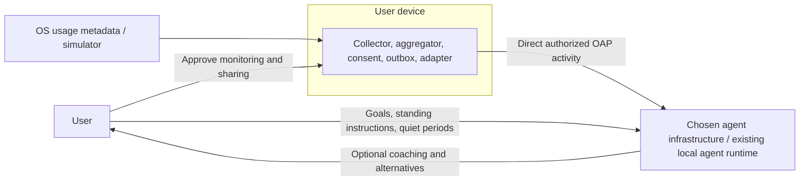
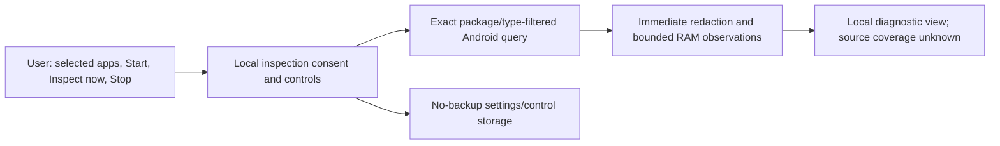
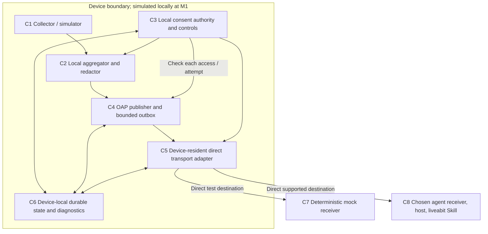

# System architecture

Version: baseline 0.2 with agreed OAP 0.1.0 refinements and accepted Android local inspection priority. Date: 2026-10-03; G1 and Windows progression acceptance: 2026-10-04; current priority: 2026-10-05. The [contract](protocol/oap.md) governs the reference; [ADR-0008](../docs/decisions/0008-windows-baseline-and-android-integration-priority.md) retains Windows progression acceptance and Linux deferral. [ADR-0009](../docs/decisions/0009-android-local-inspection-first.md) puts the native local collector/inspection before actual agent selection and integration. APK-build, host and physical Android evidence remain separate.

## Decision

**The activity provider sends directly from the user's device to the user's chosen agent infrastructure.** Collection, consent, aggregation, transport adapters, credentials and bounded pending activity live on the device. No project-operated delivery service, hosted adapter, remote consent authority, database, queue, proxy or relay is permitted. A free hosting tier or user-hosted forwarding bridge does not satisfy this constraint.

The receiving endpoint belongs to the chosen agent's existing infrastructure or runs within its existing local agent runtime. Provider-operated ingress can be part of that destination where actually supported. A separate service forwarding activity onward is an intermediary regardless of its operator.

OAP stays independent of MCP and agent vendors. Start with a direct publisher-to-mock-receiver reference profile. MCP Events is conditional: device-resident discovery, onboarding, subscription renewal and delivery must all work without an intermediary. An outbound webhook POST alone is insufficient. See [ADR-0001](../docs/decisions/0001-independent-oap-mcp-adapter.md), [ADR-0005](../docs/decisions/0005-no-intermediary-infrastructure.md) and [feasibility](../docs/research/feasibility.md).

## System context



This is the production activity path. The current local inspection prototype stops at the device and has no transport. The project supplies software and a contract, not an operated bridge. Goals and private memories stay with the agent; restriction capabilities remain outside the initial release.

## Current local Android inspection boundary

TASK-P6-F02 implements the [local collector specification](android/local-inspector.md) before M2. Plain Java keeps a JVM-testable inspection core separate from Android permission/query and UI/storage boundaries. The user selects exact packages, grants broad OS usage access separately, starts local inspection and requests each read while the app is visible. No inventory enumeration, class/content/extras access, export, background scheduling or networking is present.



This isolates C1/C2/C3/C6 preparation; it creates no recipient grant or C4/C5 delivery state. Activity remains in RAM and is cleared on Stop, fresh Start, scope mutation, authority/clock failure or process restart. Only settings/control use credential-encrypted no-backup storage. A stopped new process requires an explicit Start; normal app switching preserves the current session horizon but cancels pending reads while hidden. Query results are rechecked against current OS permission, scope, generation, lifecycle and clock state before ingestion/display. Unknown or failed authority/storage fails closed.

Only package identity, timestamp and resume/pause type are projected. Public Android query APIs do not attest initial state or complete continuity: observed events and closed inferred intervals remain local diagnostics with unknown coverage. Empty/unavailable/ambiguous history never proves zero usage; no OAP conversion or receipt exists. Source and JVM checks do not prove a merged APK manifest or physical-device behavior.

## Components and local state



| Component | Responsibility | State |
| --- | --- | --- |
| C1 | Simulate at M1; selected-package native local inspection first; later production collection; immediately discard incidental denied packages/fields | Short-lived approved device observations |
| C2 | Compute windows and coverage; apply each recipient's scope | Local permitted aggregates, no intention classification |
| C3 | Bind device/user/recipient, consent revision, scope, expiry, pause/revocation | Local grants; no remote consent replica or goals |
| C4 | Validate/persist authorized envelopes; immutable IDs; bounded replay | On-device outbox, retained history, ordering/gap metadata |
| C5 | Pair with a supported receiving endpoint; authenticate and send directly | Recipient endpoint/configuration, scoped credentials, connection state |
| C6 | Atomic local consent/outbox changes; crash recovery and safe status | Device-local state and bounded diagnostics |
| C7 | Validate, deduplicate and order synthetic records | Final mock receiver ledger; never a forwarder |
| C8 | Receive and interpret using available agent context; choose communication | Agent-owned context/receipts/retention, as supported |

An adapter is code in the device or existing agent runtime, not a hosted product component. No project-wide user account, cloud registry, shared cloud credential or remote operator dashboard is required. A local transactional store is justified by crashes, restart recovery and consent races. [ADR-0003](../docs/decisions/0003-minimal-durable-reference.md)

## Direct event delivery

```mermaid
sequenceDiagram
  participant P as Device aggregator
  participant S as Device consent / outbox
  participant A as Device transport adapter
  participant H as Chosen agent receiver
  participant U as User
  Note over A,H: A valid direct pairing/control path is required first
  P->>S: Authorized locally aggregated window
  S->>S: Redact, validate, persist immutable recipient envelope
  A->>S: Check current local consent and endpoint authorization
  A->>H: Direct authenticated event
  alt Receiver accepts
    H-->>A: Profile-defined receipt
    A->>S: Record receipt within original retention deadline
    H->>H: Validate / deduplicate / evaluate as supported
  else Network failure / timeout / lost receipt
    A->>S: Retain event and bounded retry state
    Note over S,H: Acceptance may have happened despite lost receipt
  end
  opt Allowed reconnect opportunity within retention
    A->>S: Recheck consent, expiry, rate and retry budget
    A->>H: Direct catch-up with unchanged ID and body
    H-->>A: Receipt if supported
  end
  opt History expires or capacity is exhausted
    S->>S: Evict according to policy; keep bounded gap status
    A->>H: Report missing coverage through supported profile
  end
  opt Host judges a message appropriate
    H->>U: User-authorized response or alternative
  end
  U->>S: Pause / revoke recipient locally
  S->>S: Commit and fence future reads and attempts
  A->>S: Next attempt denied, including while offline
```

No intermediate component accepts responsibility for forwarding or guaranteeing delivery. Receipt, valid consumption, evaluation and notification are distinct. C7 proves consumption in tests; C8 evidence depends on the real host.

## Pairing and authorization

```mermaid
sequenceDiagram
  participant U as User
  participant D as Device controls / consent
  participant A as Device adapter
  participant H as Chosen agent infrastructure
  U->>D: Approve monitoring and permitted metadata
  D->>U: Obtain separate OS usage access in Phase 6
  U->>D: Choose recipient, apps, fields, cadence, retention
  D->>D: Persist local grant
  U->>H: Authorize connection through supported host setup
  H-->>A: Supported endpoint / scoped pairing material
  Note over A,H: Logical requirement; no universal agent API is claimed
  A->>H: Verify identity and authenticate
  H-->>A: Accept connection and declare supported capabilities
  A->>D: Bind endpoint/credentials to local grant
  U->>H: Give standing instructions and notification preferences
  U->>D: Pause / narrow / disconnect
  D->>D: Commit locally; stop future affected reads / sends / retries
  D->>A: Purge affected queue and credentials as required
  opt Host supports cleanup
    A->>H: Best-effort unsubscribe / revoke pairing
  end
```

This is a logical lifecycle, not a finished wire API. Phase 3 must specify actual supported pairing/authentication profiles. Use host-native OAuth, keys or scoped tokens where documented; do not create a project-hosted identity service. A URL alone proves neither identity, subscription nor sending authority. A host lacking a supported onboarding/control route is unavailable; retries cannot manufacture one.

For MCP Events, the host initiates discovery/subscription and supplies the callback URL and secret to the publisher. Refresh needs control connectivity too. The phone cannot invent those credentials or use a generic chat URL. A direct/provider-owned control path must be demonstrated before outbound event delivery qualifies.

## Aggregation and protocol boundary

Default to retrospective application-duration windows. Effective collection scope is the union of active approved scopes, then recipient-specific redaction. Empty scope stops queries. Broader older-API results may enter memory transiently; discard denied fields/packages before aggregation, persistence, diagnostics or export. Never query content.

Approved raw observations stay local and are discarded after aggregation/checkpointing within the proposed 24-hour maximum and any shorter applicable limit. Clip to authorized segments or drop inseparable mixed windows with missing coverage; never prorate full-window totals to invent post-consent activity. Retry, replay, renewal, projection and republication cannot reset original retention deadlines.

Distinguish measured zero from denied access, incomplete sessions, delay and unavailable history. Foreground app durations can overlap and do not measure exact attention or elapsed screen time. Use platform-namespaced app identities and minimize cross-recipient correlation. Live/session updates remain deferred. [ADR-0002](../docs/decisions/0002-local-summary-aggregation.md)

| Planned area | Phase 3 obligation |
| --- | --- |
| PA-01 | Envelope/taxonomy, metric/coverage, identifiers, time, schemas/examples |
| PA-02 | Direct capabilities, local recipient subscriptions/filters, finite lifetimes |
| PA-03 | Host-supported pairing/auth profiles, local consent, expiry and revocation |
| PA-04 | Receipt levels, bounded retries/recovery, ordering/deduplication, replay/gaps |
| PA-05 | Size/rate/batch limits, coalescing/pagination, retention and backpressure |
| PA-06 | Versions/extensions, canonicalization and independent conformance |
| PA-07 | Direct reference transport and conditional host/MCP mappings; full lifecycle |
| PA-08 | Device-local safe status/audit interfaces and errors |

These are planning areas. The direct reference profile is mandatory; MCP is conditional. Local retained recovery does not imply a hosted history/read service or universal host-initiated subscription API.

## Reliability inside the device budget

Delivery is **best effort with bounded retry and retained recovery**. Neither eventual nor exactly-once delivery is promised. A reachable compatible receiver should receive retained records after a tested finite outage; indefinite outages, expiry, full storage, OS restrictions, unknown receipts or unsupported onboarding can still cause loss.

Improve reliability locally: persist before dispatch; immutable IDs/bodies; exponential backoff/jitter and retry hints; allowed network/foreground resumption; catch-up coalescing with honest coverage; profile-defined receipts; receiver deduplication; budgets, expiry and permanent-error stopping; durable gap/checkpoint state. Do not default to permanent Android background connections or model calls per observation.

Keep the proposed 15-minute windows, four fresh events/hour/recipient maximum, 16 KiB/event, 64 KiB catch-up, 24-hour/4 MiB history, and six attempts/cycle for review. A changed network/foreground opportunity may initiate another explicitly bounded cycle while grant/history remain valid. Phase 3 must define resets/backpressure so recovery cannot produce retry storms.

## Local revocation and security

C3 is the sole provider-side consent authority. Local pause/narrow/revoke fences new affected reads, sends and retries immediately after commit, including offline, and survives restart. Disconnecting one recipient preserves others; global monitoring off stops all OAP collection. Already-sent requests and host copies cannot be recalled.

The former remote consent authority, synchronization, pending remote-disconnect state and 20-minute lease are removed. Optional host cleanup may remain pending without weakening completed local disconnection. Published envelopes are immutable. Baseline 0.2 allowed fresh projections only with new identities and safe replacement semantics; accepted [ADR-0006](../docs/decisions/0006-immutable-finalized-summary-pages.md) defers all finalized-window projections and purges old-stream history on scope change in OAP 0.1.0.

Remote receivers require authenticated HTTPS and profile-appropriate integrity. A paired local agent may use an explicitly authorized LAN endpoint with peer authentication/encryption. Reject payload-selected destinations, redirects, untrusted peers and unexpected addresses. Remote and local profiles must have explicit destination policies; do not globally disable checks. Callback verification, signing, OAuth and rotation are conditional transport obligations, not proof a host is compatible.

## Integration and distribution

M1 uses a device simulator/publisher and its final local mock recipient. M2 must show a real existing personal agent over verified direct/provider-owned ingress, without a project service or user-hosted forwarder. An adapter/skill runs in the existing device/agent environment. A separately built API coach does not satisfy M2.

Public OpenAI MCP plugins ordinarily need stable reachable HTTPS; MCP Events additionally needs discovery/subscription/control. OpenAI-managed private MCP connectivity is a candidate because it belongs to agent-provider infrastructure, but access/setup credentials, Android execution, event behavior and distribution eligibility remain unverified. [Direct-path research](../docs/research/feasibility.md#direct-delivery-without-an-intermediary)

Mark incompatible hosts unsupported/deferred. Do not introduce a free serverless relay, public proxy, desktop forwarder, third-party tunnel or shared project credential to pass a milestone. No delivery-service subscription is required by the software; existing agent/device/network arrangements are separate.

Android collector/local inspection proceeds first from the accepted Windows baseline. Retain the prepared skill and direct-host research, with actual agent selection/integration deferred until local findings inform it. The local diagnostic app has no C4/C5 publication path. M3 replaces the simulator with a full Android publisher after a direct real M2 integration works, and still requires physical-device evidence and approved thresholds. Linux remains held; a future native OS provider can replace collection/controls without a bridge migration.
